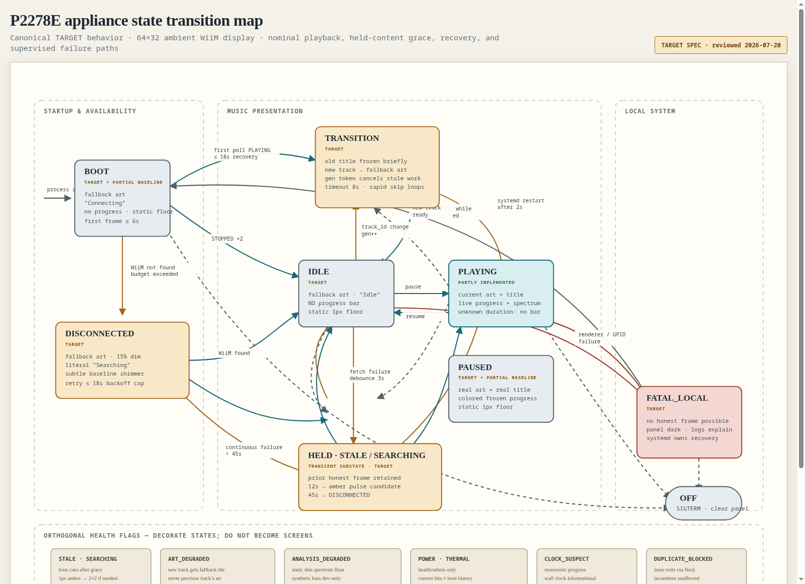

# P2278E WiiM Now-Playing Display

A calm, hi-fi now-playing appliance built from a Raspberry Pi 5, an Adafruit
RGB Matrix Bonnet, and a 64×32 HUB75 LED matrix. The left half shows album art;
the right half shows track information, progress, and a live nine-band spectrum
or levels history sourced from a WiiM/Linkplay renderer.



> **Project status:** working hardware, running as a hardened systemd appliance.
> The hardware-free test suite has 121 tests. The supported hardware profile is
> Raspberry Pi 5 + Adafruit RGB Matrix Bonnet + Adafruit P2278E 64×32 panel.

## Why this exists

Most now-playing displays look like dashboards. This one is meant to disappear
into a listening room: large pixels, restrained animation, no-crop album art,
and quiet failure behavior. If the network stutters it holds honest last-known
content rather than splashing an error across the panel.

## Features

- Automatic WiiM/Linkplay discovery over SSDP, or a configured device URL
- 32×32 no-crop album art with bounded, validated caching
- Doto title lane, progress rail, spectrum or peak/RMS history
- Four user-facing states: STARTING, NOW PLAYING, IDLE, SEARCHING
- Stable track identity and generation ownership to reject stale async work
- Configurable 15-minute no-information sleep with instant wake on recovery
- Atomic health telemetry, Pi power/thermal sampling, and frame-progress watchdog
- Independent maintenance web UI with token-gated mutations
- Native C++ spectrum analyzer using vendored KissFFT
- Hardware-free Python test suite

## Hardware

- Raspberry Pi 5
- Adafruit RGB Matrix Bonnet ([product 3211](https://www.adafruit.com/product/3211))
- Adafruit P2278E 64×32 RGB LED matrix, 4 mm pitch
- Dedicated regulated 5 V panel supply rated for at least 4 A
- Quality Raspberry Pi 5 USB-C power supply
- WiiM/Linkplay renderer on the same LAN

See [`hardware/BOM.md`](hardware/BOM.md) for the parts list and
[`hardware/POWER-ARCHITECTURE.md`](hardware/POWER-ARCHITECTURE.md) for power
options and safety notes.

> **Power safety:** never feed the panel 12/24 V, never power it from the Pi,
> and use a common ground between controller and panel. Start at low brightness.

## Try the renderer without hardware

Linux/macOS with Python 3.11+:

```bash
git clone https://github.com/keylimesoda/p2278e-wiim-display.git
cd p2278e-wiim-display/pi-app
python3 -m venv .venv
source .venv/bin/activate
python -m pip install -r requirements-dev.txt
python scripts/render_preview.py --out output/preview.png --viz spectrum
python -m pytest -q
```

The preview uses synthetic metadata and needs no WiiM, Pi, or matrix. The test
suite intentionally avoids importing the Pi-only PioMatter driver.

## Install on a Raspberry Pi 5

Start with current 64-bit Raspberry Pi OS Lite and enable SSH/networking. Wire
the Bonnet and matrix with power disconnected, then:

```bash
git clone https://github.com/keylimesoda/p2278e-wiim-display.git
cd p2278e-wiim-display/pi-app
cp config.example.json config.json
nano config.json
sudo ./scripts/install.sh
```

The installer:

1. installs Python/development headers, ffmpeg, compiler, and venv prerequisites with `apt`;
2. creates `.venv` and installs the Pi requirements;
3. builds the native KissFFT spectrum analyzer;
4. creates private runtime/token directories;
5. renders portable systemd templates for the current user/path;
6. enables the display and loopback-only admin services.

The defaults are safe for a single WiiM: leave both `wiim_base_url` and
`friendly_name` as `null` and SSDP will select the only renderer. If multiple
renderers are present, set `friendly_name` to the exact WiiM name or set
`wiim_base_url` (for example `http://wiim-hostname:49152`).

### Installer options

Pass settings as environment variables after `sudo`. User/group values must be standard Unix names, and installation paths may not contain spaces, newlines, `|`, or `&`:

```bash
sudo P2278E_USER="$USER" \
  P2278E_APP_DIR="$PWD" \
  P2278E_ADMIN_BIND=127.0.0.1 \
  ./scripts/install.sh
```

`P2278E_ADMIN_BIND=127.0.0.1` is the default. To reach the admin UI safely:

```bash
ssh -L 8787:127.0.0.1:8787 user@your-pi.local
# open http://127.0.0.1:8787/
```

Setting `P2278E_ADMIN_BIND=0.0.0.0` deliberately exposes read-only status,
track metadata, device endpoint, and diagnostics to the trusted LAN. Mutations
still require the generated token, but the UI uses plain HTTP; do not expose it
to an untrusted network or the internet.

## Configuration

`pi-app/config.json` is local and ignored by Git. Start from
[`config.example.json`](pi-app/config.example.json).

- `wiim_base_url`: optional fixed WiiM base URL
- `friendly_name`: optional exact SSDP friendly name
- `visualization`: `spectrum` or `levels`
- `brightness`: software brightness from 0.0–1.0
- `fps`: 20 or 30
- `stale_seconds`: time before the quiet stale cue
- `clear_seconds`: time before SEARCHING presentation
- `idle_dim`: dim the panel while idle
- `no_info_timeout_seconds`: black-panel sleep after continuous WiiM silence

Brightness, FPS, timing, and friendly name reload live. Visualization changes
currently require a service restart.

## Useful commands

```bash
sudo systemctl status p2278e-display p2278e-admin
sudo journalctl -u p2278e-display -f
sudo systemctl restart p2278e-display
python scripts/display_health.py
sudo cat run/admin.token
sudo ./scripts/uninstall.sh                 # preserve source/state
sudo ./scripts/uninstall.sh --purge-state   # remove runtime state too
```

If `/dev/pio0` is missing or root-only, follow Adafruit's
[Pi 5 RGB matrix guide](https://learn.adafruit.com/rgb-matrix-panels-with-raspberry-pi-5)
and install the recommended udev rule before starting the service.

## Architecture and hacking

- [`pi-app/src/p2278e_display/appliance.py`](pi-app/src/p2278e_display/appliance.py): pure state reducer and async ownership
- [`pi-app/scripts/display_live.py`](pi-app/scripts/display_live.py): workers, render loop, watchdog, telemetry
- [`pi-app/src/p2278e_display/render.py`](pi-app/src/p2278e_display/render.py): all 64×32 rasterization
- [`pi-app/src/p2278e_display/wiim.py`](pi-app/src/p2278e_display/wiim.py): SSDP, UPnP/SOAP, DIDL parsing
- [`pi-app/src/p2278e_display/audio_spectrum.py`](pi-app/src/p2278e_display/audio_spectrum.py): ffmpeg/native analyzer orchestration
- [`pi-app/src/p2278e_display/admin.py`](pi-app/src/p2278e_display/admin.py): bounded maintenance operations
- [`specs/appliance-ux-state-spec.md`](specs/appliance-ux-state-spec.md): behavior and acceptance contract
- [`specs/appliance-state-transition-map.html`](specs/appliance-state-transition-map.html): visual transition map

Start changes with the pure reducer/renderer tests. Hardware-specific behavior
belongs behind `matrix.py` so CI remains useful on ordinary Linux hosts.

## Limitations

- The PioMatter backend currently supports only the documented Pi 5/Bonnet/64×32 profile.
- Track analysis requires a media URI that ffmpeg can read; unsupported/DRM
  sources gracefully fall back to a static meter floor.
- Panel power is not observable in software; health telemetry covers the Pi.
- The installer targets Raspberry Pi OS/Debian with systemd and `apt`.
- This is an unofficial UPnP integration, not a WiiM-supported API client.

## Contributing and security

Issues and pull requests are welcome. Read [`CONTRIBUTING.md`](CONTRIBUTING.md)
before submitting changes. Please report vulnerabilities privately as described
in [`SECURITY.md`](SECURITY.md), especially anything involving the admin UI,
media URLs, filesystem writes, or LAN discovery.

## License and attribution

Project code is licensed under **GPL-2.0-only** because the Pi hardware backend
depends on Adafruit's GPL-2.0-only PioMatter package. See [`LICENSE`](LICENSE)
and [`THIRD_PARTY_NOTICES.md`](THIRD_PARTY_NOTICES.md).

This is an independent community project, not affiliated with or endorsed by
WiiM/Linkplay, Adafruit Industries, Raspberry Pi Ltd, or Dutch & Dutch.
